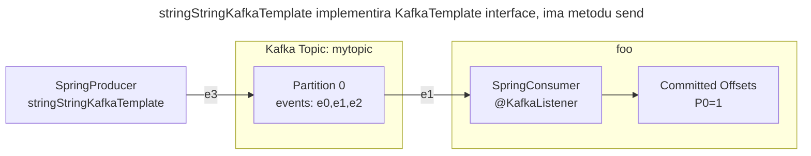
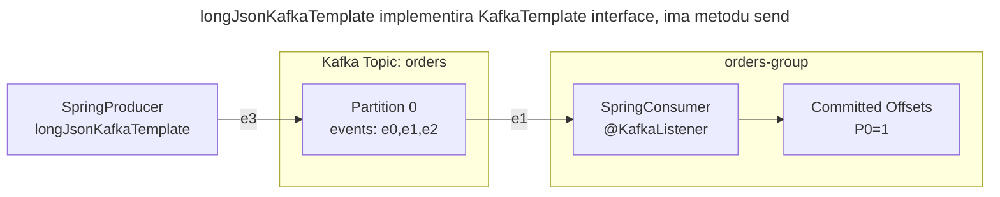
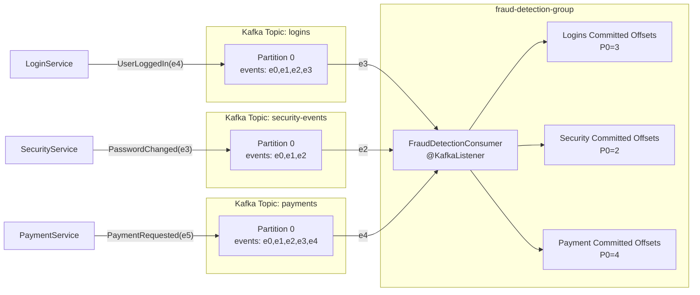
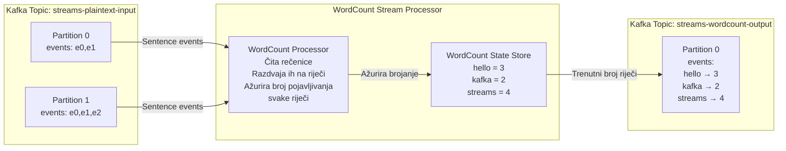
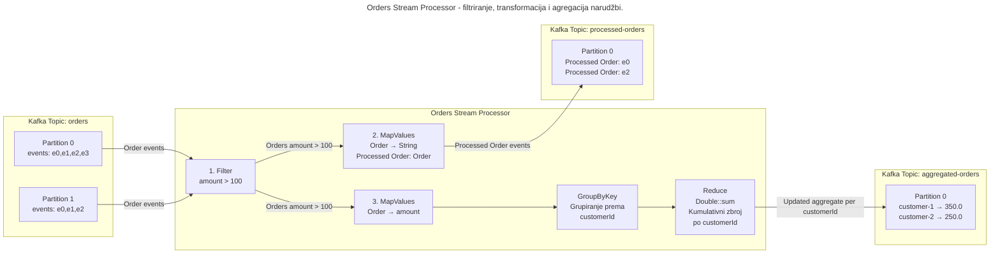
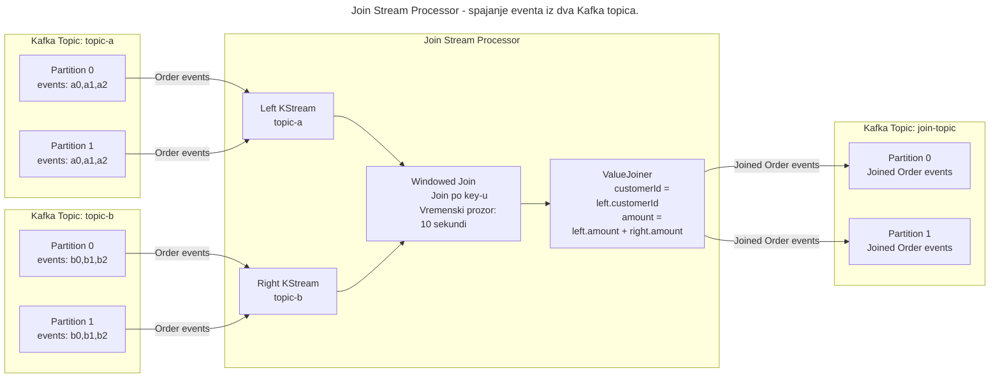
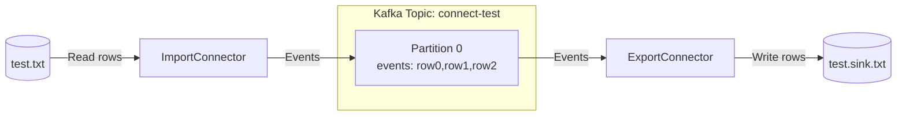
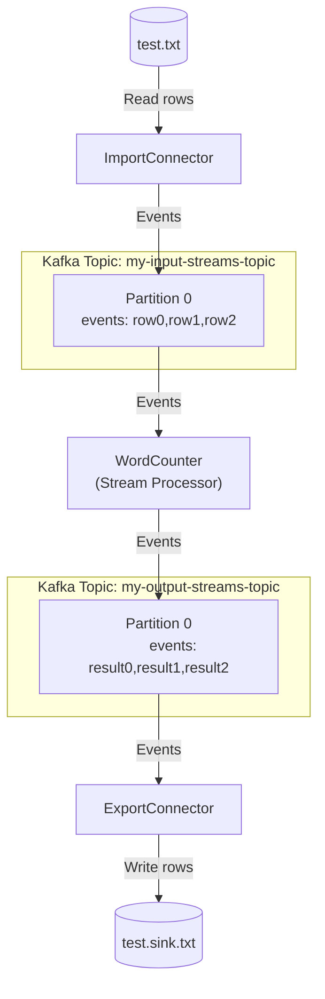

# Guide

## Producer i consumer

```bash
# Kreiraj topic
docker exec --workdir //opt/kafka -it kafka \
bin/kafka-topics.sh --bootstrap-server localhost:9092 \
--create \
--replication-factor 1 \
--partitions 1 \
--topic mytopic

# Kreiraj consumera
docker exec --workdir //opt/kafka -it kafka \
bin/kafka-console-consumer.sh --bootstrap-server localhost:9092 \
--command-property group.protocol=consumer \
--topic mytopic --group grupa-a  
```

```sh
# Kreiranje producera:
docker exec --workdir //opt/kafka -it kafka sh \
bin/kafka-console-producer.sh --bootstrap-server localhost:9092 --topic mytopic
```

```sh
# Citanje s particije
docker exec --workdir //opt/kafka -it kafka sh \
bin/kafka-console-consumer.sh \
--bootstrap-server localhost:9092 \
--topic mytopic \
--partition 0 \
--offset "5" # inicijalno procita sve offsete od 5 do kraja

# Kafka ne generira grupu za takvog consumera:
docker exec --workdir //opt/kafka -it kafka sh \
bin/kafka-consumer-groups.sh --bootstrap-server localhost:9092 --list
```

Producer i consumer za `mytopic` topic:



```bash
# Kreiraj topic
docker exec --workdir //opt/kafka -i kafka \
bin/kafka-topics.sh --bootstrap-server localhost:9092 --create \
--replication-factor 1 \
--partitions 3 \
--topic orders

# Kreiraj consumera
docker exec --workdir //opt/kafka -it kafka sh \
bin/kafka-console-consumer.sh --bootstrap-server localhost:9092 --topic orders --group grupa-b \
--command-property group.protocol=consumer \
--formatter-property print.key=true \
--formatter-property print.value=true \
--key-deserializer org.apache.kafka.common.serialization.LongDeserializer
```

```sh
# Slanje requesta na Rest endpoint
curl -X POST http://localhost:8082/kafka/order \
  -H "Content-Type: application/json" \
  -d '{
    "customerId": 1,
    "product": "Laptop",
    "amount": 1200.0
  }'

# Ili preko terminala
# event 123:{ "customerId": "123", "product": "Laptop", "amount": 100 }
docker exec --workdir //opt/kafka -it kafka \
bin/kafka-console-producer.sh --topic orders \
--bootstrap-server localhost:9092 \
--reader-property "parse.key=true" \
--reader-property "key.separator=:"
```

Producer i consumer za `orders` topic.



Fraud detection topic:

```sh
docker exec --workdir //opt/kafka -it kafka sh \
bin/kafka-topics.sh --bootstrap-server localhost:9092 \
--create --topic logins
```

```sh
docker exec --workdir //opt/kafka -it kafka sh \
bin/kafka-topics.sh --bootstrap-server localhost:9092 \
--create --topic security-events
```

```sh
docker exec --workdir //opt/kafka -it kafka sh \
bin/kafka-topics.sh --bootstrap-server localhost:9092 \
--create --topic payments
```

Produceri:

```sh
docker exec --workdir //opt/kafka -it kafka sh \
bin/kafka-console-producer.sh --bootstrap-server localhost:9092 \
--topic logins
```

```sh
docker exec --workdir //opt/kafka -it kafka sh \
bin/kafka-console-producer.sh --bootstrap-server localhost:9092 \
--topic security-events
```

```sh
docker exec --workdir //opt/kafka -it kafka sh \
bin/kafka-console-producer.sh --bootstrap-server localhost:9092 \
--topic payments
```

Consumer za fraud detection sustav:



### Streams

#### WordCountDemo

```bash
# Kreiraj input topic
docker exec --workdir //opt/kafka/ -it kafka sh \
bin/kafka-topics.sh --bootstrap-server localhost:9092 \
--create \
--replication-factor 1 \
--partitions 1 \
--topic streams-plaintext-input

# Kreiraj output topic
docker exec --workdir //opt/kafka/ -it kafka sh \
bin/kafka-topics.sh --bootstrap-server localhost:9092 \
--create \
--replication-factor 1 \
--partitions 1 \
--topic streams-wordcount-output

# Vidi detalje kreiranih topic-a
docker exec --workdir //opt/kafka/ -it kafka sh \
bin/kafka-topics.sh --bootstrap-server localhost:9092 \
--describe --topic streams-wordcount-output
```

```bash
# Pokreni WordCount aplikaciju
docker exec --workdir //opt/kafka/ -it kafka sh \
bin/kafka-run-class.sh org.apache.kafka.streams.examples.wordcount.WordCountDemo

# Pokreni producer za input topic
docker exec --workdir //opt/kafka/ -it kafka sh \
bin/kafka-console-producer.sh --bootstrap-server localhost:9092 \
--topic streams-plaintext-input

# Pokreni consumer-a
docker exec --workdir //opt/kafka/ -it kafka sh \
bin/kafka-console-consumer.sh --bootstrap-server localhost:9092 \
--command-property group.protocol=consumer \
--topic streams-wordcount-output \
--from-beginning \
--formatter-property print.key=true \
--formatter-property print.value=true \
--formatter-property key.deserializer=org.apache.kafka.common.serialization.StringDeserializer \
--formatter-property value.deserializer=org.apache.kafka.common.serialization.LongDeserializer
```



#### WordCount SpringBoot implementacija

```bash
# Kreiraj input streams topic
docker exec --workdir //opt/kafka -it kafka \
bin/kafka-topics.sh --bootstrap-server localhost:9092 --create \
--replication-factor 1 \
--partitions 1 \
--topic my-input-streams-topic

# Kreiraj output streams topic
docker exec --workdir //opt/kafka -it kafka \
bin/kafka-topics.sh --bootstrap-server localhost:9092 --create \
--replication-factor 1 \
--partitions 1 \
--topic my-output-streams-topic

# Kreiraj producera
docker exec --workdir //opt/kafka -it kafka \
bin/kafka-console-producer.sh --topic my-input-streams-topic \
--bootstrap-server localhost:9092

# Pokreni consumer-a
docker exec --workdir //opt/kafka/ -it kafka sh \
bin/kafka-console-consumer.sh --bootstrap-server localhost:9092 \
--command-property group.protocol=consumer \
--topic my-output-streams-topic \
--from-beginning \
--formatter-property print.key=true \
--formatter-property print.value=true \
--formatter-property key.deserializer=org.apache.kafka.common.serialization.StringDeserializer \
--formatter-property value.deserializer=org.apache.kafka.common.serialization.LongDeserializer
```

#### Orders procesor

```bash
# Kreiraj output streams topic
docker exec --workdir //opt/kafka -it kafka \
bin/kafka-topics.sh --bootstrap-server localhost:9092 --create \
--replication-factor 1 \
--partitions 1 \
--topic processed-orders

docker exec --workdir //opt/kafka -it kafka \
bin/kafka-topics.sh --bootstrap-server localhost:9092 --create \
--replication-factor 1 \
--partitions 1 \
--topic aggregated-orders
```

```sh
# Slanje requesta na Rest endpoint
curl -X POST http://localhost:8082/kafka/order \
  -H "Content-Type: application/json" \
  -d '{"customerId": 1, "product": "Laptop", "amount": 1200.0}'

# Consumer
docker exec --workdir //opt/kafka/ -it kafka sh \
bin/kafka-console-consumer.sh --bootstrap-server localhost:9092 \
--command-property group.protocol=consumer \
--topic aggregated-orders \
--from-beginning \
--formatter-property print.key=true \
--formatter-property  print.value=true \
--formatter-property key.deserializer=org.apache.kafka.common.serialization.LongDeserializer \
--formatter-property value.deserializer=org.apache.kafka.common.serialization.DoubleDeserializer
```



#### Join streams

```sh
# kreiranje topica
docker exec --workdir //opt/kafka -it kafka \
bin/kafka-topics.sh --bootstrap-server localhost:9092 --create \
--replication-factor 1 \
--partitions 1 \
--topic topic-a

docker exec --workdir //opt/kafka -it kafka \
bin/kafka-topics.sh --bootstrap-server localhost:9092 --create \
--replication-factor 1 \
--partitions 1 \
--topic topic-b

docker exec --workdir //opt/kafka -it kafka \
bin/kafka-topics.sh --bootstrap-server localhost:9092 --create \
--replication-factor 1 \
--partitions 1 \
--topic join-topic
```

```sh
# event 123:{ "customerId": "123", "product": "Laptop", "amount": 300 }
# event 123:{ "customerId": "123", "product": "Laptop", "amount": 400 }
# event 123:{ "customerId": "123", "product": "Laptop", "amount": 100 }
# produceri

docker exec --workdir //opt/kafka -it kafka \
bin/kafka-console-producer.sh --topic topic-a \
--bootstrap-server localhost:9092 \
--reader-property "parse.key=true" \
--reader-property "key.separator=:"

docker exec --workdir //opt/kafka -it kafka \
bin/kafka-console-producer.sh --topic topic-b \
--bootstrap-server localhost:9092 \
--reader-property "parse.key=true" \
--reader-property "key.separator=:"
```



#### Uber

```sh
docker exec --workdir //opt/kafka -it kafka \
bin/kafka-topics.sh --bootstrap-server localhost:9092 --create \
--replication-factor 1 \
--partitions 1 \
--topic driver-topic

docker exec --workdir //opt/kafka -it kafka \
bin/kafka-topics.sh --bootstrap-server localhost:9092 --create \
--replication-factor 1 \
--partitions 1 \
--topic ride-topic

docker exec --workdir //opt/kafka -it kafka \
bin/kafka-topics.sh --bootstrap-server localhost:9092 --create \
--replication-factor 1 \
--partitions 1 \
--topic active-requests

docker exec --workdir //opt/kafka -it kafka \
bin/kafka-console-producer.sh --topic driver-topic \
--bootstrap-server localhost:9092 \
--reader-property "parse.key=true" \
--reader-property "key.separator=:"

docker exec --workdir //opt/kafka -it kafka \
bin/kafka-console-producer.sh --topic ride-topic \
--bootstrap-server localhost:9092 \
--reader-property "parse.key=true" \
--reader-property "key.separator=:"

# d-2:{ "driverId": "d-2", "lat": 45.81, "lon": 44.97}
# d-2:{ "rideId": "r-1", "driverId": "d-2", "lat": 45.8105, "lon": 55.97027 }
```

#### Branching

```sh
docker exec --workdir //opt/kafka -it kafka \
bin/kafka-topics.sh --bootstrap-server localhost:9092 --create \
--replication-factor 1 \
--partitions 1 \
--topic transactions-input

docker exec --workdir //opt/kafka -it kafka \
bin/kafka-topics.sh --bootstrap-server localhost:9092 --create \
--replication-factor 1 \
--partitions 1 \
--topic transactions-approved

docker exec --workdir //opt/kafka -it kafka \
bin/kafka-topics.sh --bootstrap-server localhost:9092 --create \
--replication-factor 1 \
--partitions 1 \
--topic transactions-rejected

docker exec --workdir //opt/kafka -it kafka \
bin/kafka-topics.sh --bootstrap-server localhost:9092 --create \
--replication-factor 1 \
--partitions 1 \
--topic transactions-pending

docker exec --workdir //opt/kafka -it kafka \
bin/kafka-topics.sh --bootstrap-server localhost:9092 --create \
--replication-factor 1 \
--partitions 1 \
--topic transactions-unknown

# { "transactionId": "tx-1001", "accountId": "acc-55", "amount": 250.75, "status": "PENDING" }
# { "transactionId": "tx-1002", "accountId": "acc-55", "amount": 20.75, "status": "REJECTED" }

docker exec --workdir //opt/kafka -it kafka \
bin/kafka-console-producer.sh --topic transactions-input \
--bootstrap-server localhost:9092
```

## Kafka Connect API

Kopirati config datoteke lokalno:

```sh
docker cp kafka:/opt/kafka/config .
```

Stop postojećeg servera:

```sh
docker compose down -v
```

Dodati u docker-compose.yaml:

```yaml
volumes:
  - ~/dev/Edukacije/KafkaRadionica:/home/appuser/shared:rw
  - ~/dev/Edukacije/KafkaRadionica/config:/opt/kafka/config:rw
```

Ponovo pokreni Kafka servis:

```sh
docker compose up -d 
```

Uđemo u container:

```sh
docker exec --workdir //opt/kafka -it kafka sh
```

Konfiguriranje konektora:

U config/connect-standalone.properties dodati:

```txt
plugin.path=libs/connect-file-4.3.1.jar
```

U config/connect-file-source.properties postaviti file putanju:

```txt
file=/home/appuser/shared/test.txt
```

U config/connect-file-sink.properties postaviti file putanju:

```txt
file=/home/appuser/shared/test.sink.txt
```

Pokretanje konektora:

```bash
# Pokreni connectore
docker exec --workdir //opt/kafka -it kafka sh \
bin/connect-standalone.sh config/connect-standalone.properties config/connect-file-source.properties config/connect-file-sink.properties
```

```sh
docker exec --workdir //opt/kafka -it kafka sh \
bin/kafka-console-consumer.sh --bootstrap-server localhost:9092 \
--topic connect-test --group test-group \
--command-property group.protocol=consumer
```



### Zadatak

Obriši sadržaj test.sink.txt datoteke.

```sh
# Kreiraj input streams topic
docker exec --workdir //opt/kafka -it kafka \
bin/kafka-topics.sh --bootstrap-server localhost:9092 --create \
--replication-factor 1 \
--partitions 1 \
--topic my-input-streams-topic

# Kreiraj output streams topic
docker exec --workdir //opt/kafka -it kafka \
bin/kafka-topics.sh --bootstrap-server localhost:9092 --create \
--replication-factor 1 \
--partitions 1 \
--topic my-output-streams-topic
```

U connect-file-source.properties staviti:

```txt
topic=my-input-streams-topic
```

U connect-file-sink.properties staviti:

```txt
topics=my-output-streams-topic
key.converter=org.apache.kafka.connect.storage.StringConverter
value.converter=org.apache.kafka.connect.converters.LongConverter
```

U config/connect-standalone.properties postaviti:

```txt
key.converter=org.apache.kafka.connect.storage.StringConverter
value.converter=org.apache.kafka.connect.storage.StringConverter
key.converter.schemas.enable=false
value.converter.schemas.enable=false
```

Schemas.enable=true očekuje: { "schema": ..., "payload": ...}
A schemas.enable=false očekuje čisti json: {"id":3,"ime":"Marko"}


